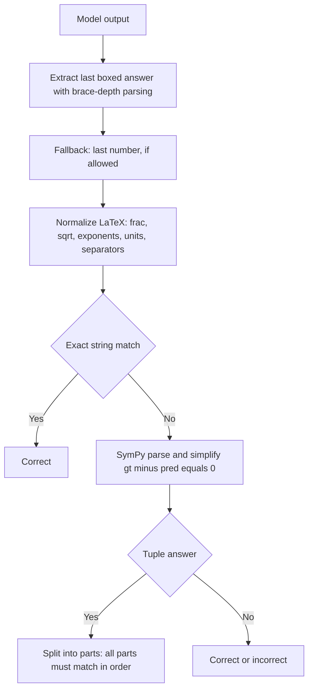

# MATH-500

## Definition

**MATH-500** is a 500-problem subset of the MATH competition-math dataset (Hendrycks et al., arXiv 2103.03874). MATH has about 12,500 problems covering algebra, geometry, probability, number theory and more. The 500-problem split was proposed in OpenAI's "Let's Verify Step by Step" (Lightman et al., arXiv 2305.20050), originally in the PRM800K repository. It is hosted on Hugging Face as `HuggingFaceH4/MATH-500`. Each record has `problem`, `answer`, `solution`, `subject`, `level` and `unique_id` fields (Raschka 2026, p81–83, p307).

It is a standard benchmark for [[Reasoning Models]]. For example, [[DeepSeek-R1]] reports 97.3% on it.

## Why it is used

Raschka gives four reasons for using it instead of [[GSM8K]] (p82):
- It is a manageable size.
- The remaining roughly 12,000 MATH problems form a training set that doesn't overlap with it, which avoids data leakage in [[RLVR]] and [[Distillation]] (p193).
- It is common in the literature.
- It is harder than GSM8K, and its answers suit symbolic verification.

## Verifier-based scoring

Answers are free-form and checked by a deterministic verifier. An LLM judge is not used (p59–80):

Edge cases the book tests (p79–80, p315–316):
- 0.5 equals 1/2.
- 0.3333333333 does **not** equal 1/3, and 50% does **not** equal 1/2.
- (2,1) does not equal (1,2): order matters.
- A Unicode minus (U+2212) fails unless it is normalized first.

## Pitfalls

- **Small subsets mislead.** The first 10 problems gave the base model 30% and the reasoning model 90%. On all 500 the scores were 15.3% and 48.2% (Table B.2, p319).
- **Prompt sensitivity.** Using "Problem:" instead of "Question:" lifted [[Qwen3]] 0.6B base from 15.3% to 31.2%, which suggests memorized formatting. The reasoning model only moved from 48.2% to 50.0% (p320).
- **Contamination.** Overlap with training data "cannot be ruled out". On a new set of 50 MATH-style problems, the base model scored 36% and the reasoning model 80%. The author saw no sign of extensive overfitting to MATH-500 (p320).
- **Different setups give different numbers.** The book scores DeepSeek-R1 at 91.2%, while its paper reports 97.3%. The prompt, sampling and verifier all differ.

## Reference results from the book

All on Qwen3 0.6B, 500 problems:

| Setup | Accuracy | Source |
|---|---|---|
| Base, greedy | 15.2% | Table 4.1 |
| Base + CoT | 40.6% | Table 4.1 |
| Base + SC n=10 + CoT | 52.0% | Table 4.1 |
| Base + GRPO, 50 steps | 47.4% | Table 6.1 |
| Base distilled from Qwen3 235B-A22B | 44.2–45.0% | Table 8.1 |
| Reasoning variant, greedy | 48.2% | Table 4.1 |
| Reasoning + self-refinement with heuristic scorer | 57.8% | Table 5.1 |

Teachers in the book's setup: Qwen3 235B-A22B 92.4%, DeepSeek-R1 91.2% (p300).

## Related Concepts

- [[GSM8K]] — easier grade-school math benchmark
- [[MMLU]] — multiple-choice knowledge benchmark
- [[RLVR]] — uses the same verifier as a training reward
- [[Process Reward Model]] — PRM800K step labels come from the same OpenAI work
- [[Self-Consistency]], [[Self-Refinement]], [[Chain-of-Thought]] — methods compared on it

## Sources

- [[2026-11-13-build-a-reasoning-model-from-scratch]] — Raschka 2026, chapter 3 and Appendix B
- [[2026-05-09-deepseek-r1]] — R1 MATH-500 result
