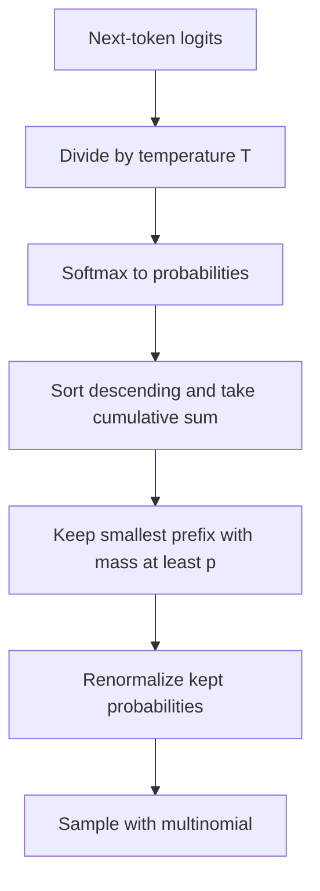

# Nucleus Sampling

## Definition

**Nucleus (top-p) sampling** is a decoding strategy that samples the next token only from the *smallest set of tokens whose cumulative probability is at least p*. The rest of the vocabulary is discarded and the kept probabilities are renormalized. It is almost always used together with **temperature scaling**. Together the two control how diverse sampled text is, as opposed to always taking the most likely token (greedy decoding) (Raschka 2026, p107–127).

## The decoding pipeline

### Temperature
- **How it works.** Logits are divided by T before the softmax (p107–108):
  - T = 1 leaves them unchanged.
  - T < 1 sharpens the distribution, making the model more confident.
  - T > 1 flattens it, making output more diverse.
- **Constraints.** T must be positive; T → 0 behaves like greedy decoding (argmax).
- **Example** (prompt "The capital of Germany is", p110–115). The probability of "Berlin" is 0.0003 at T = 5 and 0.3398 at T = 0.5. Over 1,000 samples at T = 5 the output is mostly nonsense tokens. At T = 0.35, "Berlin" appears 435 times.
- **Guidance** (p117):

| Temperature | Use |
|---|---|
| 0.0 | Greedy decoding |
| 0.3–0.8 | A little diversity |
| Much higher | Creative work or broad search; reliability suffers |

### Top-p
- **Two variants** (p118–126):
  - The simple rule keeps tokens while `cumsum ≤ p`.
  - The common variant also keeps the token that *crosses* the threshold, which matches the "smallest set with mass ≥ p" definition.
- **Two practical requirements.** Always keep the top token. Renormalize afterward, because the kept probabilities no longer sum to 1.
- **Typical value.** 0.8 is "a typical value". With T = 0.35 and top-p 0.8, the low-probability alternatives in the Berlin example (Munich, Hamburg) were removed entirely.

### Top-k
Top-k keeps a fixed number k of tokens, while top-p keeps a variable number based on probability mass. Top-p has become the more popular of the two (p127).

## Role in reasoning pipelines

- **Diversity alone is not inference-time scaling.** On [[MATH-500]] with [[Qwen3]] 0.6B base, temperature 0.9 + top-p 0.9 scored 17.8%, against 15.2% for greedy decoding. Added to CoT, sampling *lowered* accuracy from 40.6% to 33.4% (Table 4.1, p133–134).
- **Where it pays off:** generating diverse candidates for [[Self-Consistency]] voting, and producing rollouts in [[GRPO]] training (temperature 0.8, top-p 0.9; "common 0.7–0.9") (p212, p219).
- **Settings to start from for self-consistency:** T about 0.5–0.9, top-p about 0.7–0.9. If the samples are near-identical, raise them. If they are nonsensical, lower the temperature first (p132).
- **Temperature does not change the model.** Raising the sampling temperature diversifies rollouts but leaves the model's own entropy unchanged (p242).
- **Implementation note.** `torch.multinomial` results can differ, or crash, on CUDA and MPS (PyTorch 2.9), so the book samples on the CPU (p113).

## Related Concepts

- [[Beam Search]] — deterministic search-based alternative
- [[Speculative Decoding]] — inference acceleration that preserves the sampling distribution
- [[Self-Consistency]] — main consumer of sampled diversity
- [[GRPO]] — rollout sampling during RL
- [[Test-Time Compute Scaling]] — broader context

## Sources

- [[2026-11-13-build-a-reasoning-model-from-scratch]] — Raschka 2026, chapter 4
