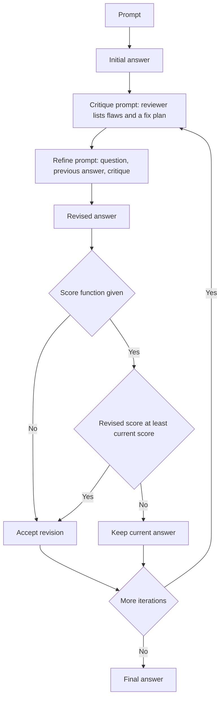

# Self-Refinement

## Definition

**Self-refinement** is an inference-time scaling technique. The model writes an answer, critiques it, and revises it, repeating for a set number of iterations. [[Self-Consistency]] samples many answers and picks one; self-refinement instead improves a **single** answer step by step. It is the iterative family of [[Test-Time Compute Scaling]], alongside sequential long [[Chain-of-Thought]] and parallel sampling (Raschka 2026, p96, p136).

The method's advantage is that it does not need a short final answer that can be voted on, so it can also handle open-ended problems. Self-consistency can't (p134, p138).

## The loop

These are the book's defaults (p167–174):
- **Critique prompt.** "You are a meticulous reviewer…" asks for a short critique and a bullet-point fix plan of under about 120 words, capped at 256 tokens.
- **Sampling.** Temperature 0.7 and top-p 0.9.
- **Revision rule.** A revision is accepted only if its score is at least the current score. With no scorer, the latest revision always wins.

A critique can contain factual errors, such as claiming the question is incomplete, and still help. It is useful as long as it pushes the revision in a better direction overall (p170).

## Scorers

A scorer ranks candidate answers when the true answer is unknown at inference time, which is why it is a *scorer* and not a verifier (p142–145). The book names three kinds:

1. **Heuristic (rule-based).** `heuristic_score` gives points for format and brevity, not for correctness:
   - +2.0 if the answer is in `\boxed{}`;
   - +1.0 if a bare number can be extracted;
   - plus a brevity bonus of $1.5 \cdot e^{-\text{chars}/500}$.

   Tuning: raise the extraction bonus if the scorer favors answers that can't be parsed, and raise the brevity pressure if it favors rambling (p146).
2. **Another LLM** as judge. See [[LLM-as-Judge]].
3. **The model's own probabilities.** This is the average per-token log-probability of the answer tokens, with prompt tokens excluded. Averaging normalizes for length (p162–165).

**Why logprob scoring is risky.** It measures how *natural* the model finds an answer, not whether the answer is correct. It therefore favors "confident mistakes" (p147–148, p166). A sequence's probability is not a calibrated probability of being correct (p155). No sampling strategy, greedy included, guarantees the most probable sequence, and even that sequence might be wrong (p152).

The same scorers can also break [[Self-Consistency]] ties, or replace the vote entirely. Replacing the vote is called **best-of-N** (p139, p146).

## Evidence

[[Qwen3]] 0.6B on [[MATH-500]], all 500 problems, DGX Spark (Table 5.1, p176):

| Model | Scorer | Iterations | Accuracy | Time |
|---|---|---|---|---|
| Base | (baseline) | — | 15.2% | 10.1 min |
| Base | none | 1 | **25.0%** | 84.8 min |
| Base | none | 2 | 22.0% | 165.4 min |
| Base | heuristic | 1 | 21.6% | 84.7 min |
| Base | avg. logprob | 1 | 21.4% | 85.3 min |
| Reasoning | (baseline) | — | 48.2% | 182.1 min |
| Reasoning | none | 1 | 56.6% | 498.8 min |
| Reasoning | heuristic | 1 | **57.8%** | 498.6 min |
| Reasoning | avg. logprob | 1 | 48.4% | 499.7 min |

Reading the table (p176–177):
- **Base model.** The gain is modest, and the best result uses *no* scorer, because scorers can swap a correct initial answer for a wrong revision. More iterations can make answers worse.
- **Reasoning model.** With the heuristic scorer, accuracy rises by almost 10 points.
- **Logprob scoring** came last in both settings.
- **Compared with self-consistency,** self-refinement was less effective for this model and task.
- **Self-refinement is inherently sequential,** so simple batching gives it little benefit (p374).

## In frontier systems

The book cites DeepSeekMath-V2 (Nov 2025, arXiv 2511.22570) (p177, p309). That system trains a separate critique and verifier model plus a solver trained for self-refinement. Combined with self-consistency (their "Best@32"), it reached gold-level performance in several math competitions.

## Related Concepts

- [[Self-Consistency]] — parallel alternative; needs answers that can be voted on
- [[Reflexion]] — agent-loop relative with memory of past failures
- [[Test-Time Compute Scaling]] — parent family
- [[LLM-as-Judge]] — external scorer option
- [[Process Reward Model]] — learned step-level scoring
- [[Chain-of-Thought]] — sequential substrate
- [[Reasoning Models]] — where the largest gains appeared

## Sources

- [[2026-11-13-build-a-reasoning-model-from-scratch]] — Raschka 2026, chapter 5 and exercises 5.1–5.5
