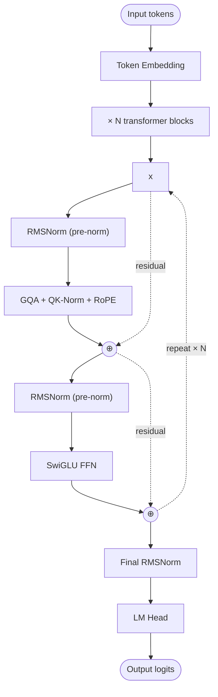
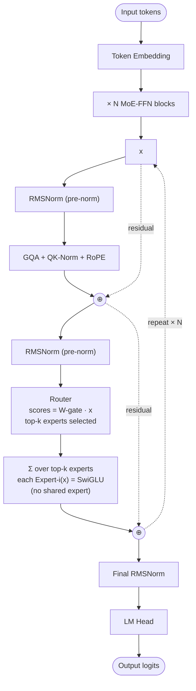

# Qwen3 — Architecture

## Identity

Qwen3 ([[Alibaba]] Qwen team, **April 28, 2025**) is the broadest open-weight LLM family of 2025 — sizes from **0.6B to 235B** spanning both **dense** and **sparse MoE**. The recipe: [[Grouped-Query Attention|GQA]] + [[QK-Norm]] + [[RMSNorm]] pre-norm + [[SwiGLU]] + [[Rotary Position Embeddings|RoPE]] for all variants, with MoE swapping in for the FFN at large scales.

| Variant | Released | Total / Active | Architecture |
|---|---|---|---|
| Qwen3 0.6B | 2025-04-28 | 0.6B | Dense, 28 layers |
| Qwen3 4B | 2025-04-28 | 4B | Dense |
| Qwen3 8B | 2025-04-28 | 8B | Dense |
| Qwen3 14B | 2025-04-28 | 14B | Dense |
| Qwen3 32B | 2025-04-28 | 32B | Dense |
| Qwen3 30B-A3B | 2025-04-28 | 30B / 3B | Sparse [[Mixture of Experts\|MoE]] (10% active) |
| Qwen3 235B-A22B | 2025-04-28 | 235B / 22B | Sparse MoE; no shared expert |
| Qwen3 Coder Flash 30B-A3B | 2025-07-31 | 30B / 3B | MoE; 256K context, code |
| Qwen3 Next 80B-A3B | 2025-09-09 | 80B / 3B | **Hybrid** (Gated DeltaNet + Gated Attention) |
| Qwen3.5 397B | 2026-02-16 | ~397B | **Hybrid** (Gated DeltaNet + Gated Attention) |
| Qwen3.6 35B-A3B | 2026 | 35B / 3B | MoE + Gated DeltaNet |
| Qwen3.6 27B | 2026 | 27B | Dense |

## Block diagram (dense, e.g., Qwen3 32B)



## Block diagram (MoE, e.g., Qwen3 235B-A22B)



Qwen3 235B-A22B has **no shared expert** — a notable departure from [[DeepSeek-V3]]'s shared-expert design.

## Qwen3 Next / Qwen3.5 (hybrid architectures)

Qwen3 Next 80B-A3B (Sept 2025) and Qwen3.5 397B (Feb 2026) replace standard attention with a **hybrid mix of [[Linear Attention|Gated DeltaNet]] and Gated Attention** layers. This is Qwen's bet on sub-quadratic attention at frontier scale.

```
Hybrid layer alternation:
   Layer 1: Gated DeltaNet (linear attention)
   Layer 2: Gated DeltaNet
   Layer 3: Gated DeltaNet
   Layer 4: Gated Attention (full attention with gating)
   ...
```

The Gated DeltaNet layers are linear-time; Gated Attention layers preserve in-context-learning capability.

## Recipe diff vs Llama 3

| Component | Llama 3 8B | Qwen3 8B |
|---|---|---|
| QK-Norm | No | **Yes** |
| Attention | GQA 4:1 | GQA |
| FFN | SwiGLU | SwiGLU |
| Position | RoPE | RoPE |
| Norm | RMSNorm pre-norm | RMSNorm + QK-Norm pre-norm |
| Has MoE variants | No (Llama 3) | **Yes** (30B-A3B, 235B-A22B) |
| Has hybrid variants | No | **Yes** (Next, 3.5) |

Qwen3's distinguishing choices: ubiquitous **QK-Norm**, **no shared expert** in 235B MoE, and aggressive **hybrid/linear-attention experimentation** in later releases.

## Qwen3 0.6B as a teaching model

The 0.6B model is the base model throughout *Build a Reasoning Model (From Scratch)* (Raschka 2026). The book reimplements it in pure PyTorch, compatible with the official weights.

**Why this model** (p29). It is the smallest model in the family and runs on consumer hardware. It ships as both a **base** and an official **reasoning** variant, so the reasoning variant can serve as a reference.

**`QWEN_CONFIG_06_B`** (Listing C.7, p351):

| Setting | Value |
|---|---|
| Vocabulary | 151,936 |
| Context length | 40,960 |
| Embedding dim | 1,024 |
| Layers | 28 |
| Query heads | 16 |
| KV groups | 8 |
| Head dim | 128 |
| FFN hidden dim | 3,072 |
| QK-Norm | on |
| RoPE base | 1,000,000 |
| dtype | bfloat16 |

**Context budget** (p351–352). The model was trained with 32,768 tokens of context. The 40,960 default reserves 32,768 tokens for output and 8,192 for the prompt. The Qwen developers advise against YaRN context extension unless the average context regularly exceeds about 32,000 tokens, because it can slightly hurt performance on shorter inputs.

**Hybrid thinking.** The non-base 0.6B model supports both thinking and non-thinking modes. With thinking off, the chat template inserts an empty `<think>

</think>` block (p354–355).

**Larger dense variants.** The same code loads the bigger dense checkpoints (Table D.1/D.2, Fig. D.1, p358–360). bf16 memory figures are lower bounds for the weights alone:

| Model | Embedding dim | FFN hidden dim | bf16 weights |
|---|---|---|---|
| 1.7B | 2,048 | 6,144 | ~3.4 GB |
| 4B | 2,560 | 9,728 | ~8 GB |
| 8B | 4,096 | 12,288 | ~16 GB |
| 14B | 5,120 | 17,408 | ~28 GB |
| 32B | 5,120 | 25,600 | ~64 GB |

Notes on the larger variants:
- **1.7B** is missing from the variant table above.
- **Hub IDs.** Base and reasoning checkpoints have different Hugging Face IDs, for example `Qwen/Qwen3-4B-Base` vs `Qwen/Qwen3-4B` (p361–363).
- **MoE variants** are not supported by the book's code.

**[[MATH-500]] scores of the 0.6B models** from the book are in [[Reasoning Models]]. The headline numbers: base 15.2%, reasoning 48.2%. Distillation results with Qwen3 235B-A22B as teacher are in [[Distillation]]. That teacher scores 92.4% on MATH-500 (p300).

## Connections

- [[Grouped-Query Attention]], [[QK-Norm]], [[RMSNorm]], [[SwiGLU]], [[Rotary Position Embeddings]]
- [[Mixture of Experts]] — MoE variants
- [[Linear Attention]] — Gated DeltaNet in Qwen3 Next/3.5
- [[Alibaba]] — parent org
- [[Qwen2.5-VL]] — vision-language sibling
- [[LLM Architecture]] — hub
- [[LLM Architecture Landscape 2026]] — comparative synthesis
- [[2026-05-28-raschka-llm-architecture-gallery]] — source
- [[2026-11-13-build-a-reasoning-model-from-scratch]] — from-scratch Qwen3 0.6B implementation, configs for larger dense variants
- [[Reasoning Models]], [[GRPO]], [[Distillation]] — book experiments built on Qwen3 0.6B

## Open Questions

- Why no shared expert in 235B-A22B? (Counter to DeepSeek's recipe.)
- Gated DeltaNet vs Lightning Attention vs Mamba-2 — which linear-attention variant wins at frontier scale?
- Will Qwen 4 commit fully to hybrid architectures or split dense/hybrid lineages?
